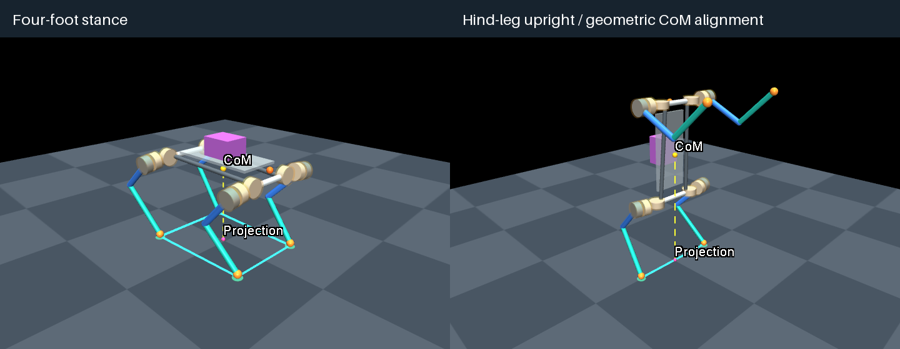

# Quadruped Morphology Workbench

A lightweight MuJoCo workbench for parametric quadruped design, inverse-kinematics pose exploration, payload modeling, and center-of-mass visualization.

[中文说明](README_ZH.md) · [Detailed controls](README_EN.md) · [Sources and provenance](SOURCES.md)

Implementation principles: [English](documents/kinematics-dynamics-en.md) · [中文](documents/kinematics-dynamics-zh.md). Covers analytic IK, mass/inertia, support geometry and static joint loads.



## Features

- Generate a twelve-joint floating-base quadruped from TOML parameters: separate front/hind link lengths, shoulder/hip spacings and vertical offset.
- Explore coaxial, proximally mounted hip/knee drive-module geometry, nominal module masses and clearance envelopes.
- Adjust body height, pitch and foot targets with analytic inverse kinematics, including the lateral upper-link offset.
- Switch between four-foot and hind-leg upright **frozen poses**, preserving each mode's targets.
- Adjust mirrored shoulder roll, shoulder pitch and elbow angle in the upright **Front limbs** controls, with live CoM feedback.
- Attach an independent fixed box payload and recompute mass, center of mass (CoM) and inertia.
- Inspect each rigid body or its descendants: mass breakdown, local/world CoM, inertia, joint angles and derived dimensions, with a highlighted selection.
- Visualize the CoM, its ground projection, and a four-foot support polygon or two-foot support segment.
- Align the projected CoM by searching bounded foot targets and rerunning IK and geometry checks.
- Evaluate a gravity-only static baseline with equal left/right vertical loads; report joint-output torque demands only when whole-model equilibrium checks pass.
- Save reproducible candidates with configuration, MJCF, validation report and rendered image.

## Foundation and research references

This is a standalone Python implementation built on **[MuJoCo](https://github.com/google-deepmind/mujoco)**, with NumPy, Pillow and Tkinter. The robot generators, parameter UI, analytic IK and validation code were developed in this project with AI-assisted coding using OpenAI Codex.

The initial research direction was informed by **[Transformer Transformer: A Unified Model for Motion-Conditioned Robot Co-design](https://github.com/real-stanford/transformer-transformer)**. It is a research reference, rather than an upstream codebase used by this version: **no code, robot assets, datasets, trained models or training pipeline from Transformer Transformer are included.** The current generator is independently implemented. See [SOURCES.md](SOURCES.md) for the full provenance and dependency distinction.

## Install

Developed and tested on **macOS / Apple Silicon**, using Python **3.12**. No CUDA or RL framework is required. Install [uv](https://docs.astral.sh/uv/getting-started/installation/) first, then:

```sh
git clone https://github.com/peiyuwang1018/quadruped-morphology-workbench.git
cd quadruped-morphology-workbench
uv sync --locked
```

Python and dependency versions are recorded in `.python-version`, `pyproject.toml` and `uv.lock`. The internal Python module remains `quadruped_codesign`; it does not need to match the repository name.

The desktop panel needs a Python build with Tk support and an active graphical session. Check Tk before opening it:

```sh
.venv/bin/python -c "import tkinter; print('Tk', tkinter.TkVersion)"
```

## Run

```sh
.venv/bin/python -m quadruped_codesign.cli panel --config configs/fusion_reference.toml
```

On macOS, you can also double-click **Open Workbench.command** after creating the environment. The Tk panel uses ordinary Python; the separate native MuJoCo viewer requires `mjpython` on macOS.

Try the first interaction:

1. In **Stance**, choose **Hind-leg upright**.
2. Observe the gold CoM, pink ground projection and cyan support segment. Click **Align CoM projection** and compare the line error.
3. Switch back to **Four-foot stance**, or select **Save config & model** to keep the candidate.

The Fusion panel displays distances in **mm**, angles in **degrees**, and mass in **kg**. Configuration and MJCF files use SI units. CoM readouts use world coordinates. Invalid inputs keep the previous valid preview and disable saving.

Toggle **Inspect** above the preview to replace the parameter sidebar with **Mass / Pose / Model / Static** readouts. Choose a body and either **Selected body** or **Body + descendants**. Static checks the whole model under an explicit load-sharing rule. Uncheck **Inspect** to edit parameters again. See [model inspector](docs/model-inspector.md) and [static loads](docs/static-loads.md) for short experiments and definitions.

## Generate and inspect without the panel

```sh
.venv/bin/python -m quadruped_codesign.cli generate \
  --config configs/fusion_reference.toml --output outputs/robot.xml
.venv/bin/python -m quadruped_codesign.cli check outputs/robot.xml
```

Optional frozen native viewer on macOS:

```sh
.venv/bin/mjpython -m quadruped_codesign.cli view outputs/robot.xml
```

Saved panel candidates appear under `outputs/panel/<timestamp>/`:

| File | Contents |
|---|---|
| `config.toml` | Morphology, both pose settings, mounting assumptions and bounds |
| `robot.xml` | Corresponding compiled-compatible MuJoCo MJCF |
| `validation.json` | Kinematics, mass/inertia checks, support geometry, body inspection, static loads and scope |
| `preview.png` | Current camera render, including enabled overlays |
| `README.txt` | Snapshot scope and reopening instructions |

Generated outputs and local virtual environments are excluded from Git. `demo`, `study`, `configs/morphology.toml` and `configs/payload.toml` retain the early eight-joint teaching model; saved Fusion v1 profiles retain their earlier layout.

## Modeling scope

This is an early research tool for **geometry and pose inspection**. The current twelve-joint profile has **zero actuators**: transmission ratios, coupled drive equations, rotor inertia, torque/speed limits and controllers remain to be modeled. It is not yet a morphology–control optimization or RL training pipeline, and Isaac Lab conversion has not been validated.

Module shapes, link density, frame mass, joint ranges and some mounting offsets are explicit approximations. The default model mass of about 30.53 kg is a consequence of those assumptions, not a calibrated hardware prediction. Upright mode uses its own provisional hip range, approximately −77° to +160°, displayed in the UI and saved in the configuration.

Four-foot projection inside a support polygon is a geometric check. Two ideal point feet form a zero-area support segment; alignment to that segment does not verify stable balance, contact-force feasibility or actuator capacity. No standing or walking controller is provided. Collision checks cover the declared proxy geometry at the inspected pose, not full CAD assembly clearance.

The separate **Static** check uses equal left/right, nonnegative vertical foot loads and evaluates both world wrench balance and the unactuated floating-base residual. Its torques are ideal joint-output requirements, not motor-shaft loads or capacity checks. Lateral CoM offsets are outside this first equal-sharing baseline. Unbalanced candidates remain saveable and have no reported standing-torque solution. Details: [static-load assumptions](docs/static-loads.md).

Details: [Fusion model assumptions](docs/fusion-reference.md) · [Pose switching and support geometry](docs/support-preview.md).

## Tests

```sh
.venv/bin/python -m unittest discover -s tests -v
# Include native Tk/OpenGL and rendered-pixel checks on an active desktop:
QUADRUPED_UI_TESTS=1 .venv/bin/python -m unittest discover -s tests -v
```

The desktop suite covers analytic FK/IK, masses/inertia, motor ownership and placement, mirrored front-limb edits, body/subtree inspection with rotated inertia aggregation, invalid-input rollback, snapshot round trips, support geometry, bounded alignment and renderer replacement. Linux deployment and workstation training require separate validation.

## Layout

```text
configs/                       TOML reference and legacy configurations
src/quadruped_codesign/
  fusion.py                    Twelve-joint model generation and analytic IK
  panel.py, fusion_panel.py    Native English parameter UI
  panel_model.py               Configuration and candidate snapshots
  mass_properties.py           Mass, CoM and inertia calculations
  inspection.py                Compiled body/subtree and pose readouts
  statics.py                   Vertical pair loads and ideal joint-output demands
  inspector_panel.py           Read-only inspector and scope selection
  support.py, posture.py       Support geometry, overlay and bounded alignment
  generator.py, validation.py  Legacy generator and numerical checks
  visualization.py, cli.py     MuJoCo rendering, viewer and commands
assets/base_quadruped.xml       Original local regression fixture
examples/                      Legacy Python API example
tests/                         Numerical and optional desktop regression tests
docs/                          Model assumptions and support-preview details
```

## License

A project license has not yet been selected. Third-party dependencies and research references retain their own licenses; see [SOURCES.md](SOURCES.md).
