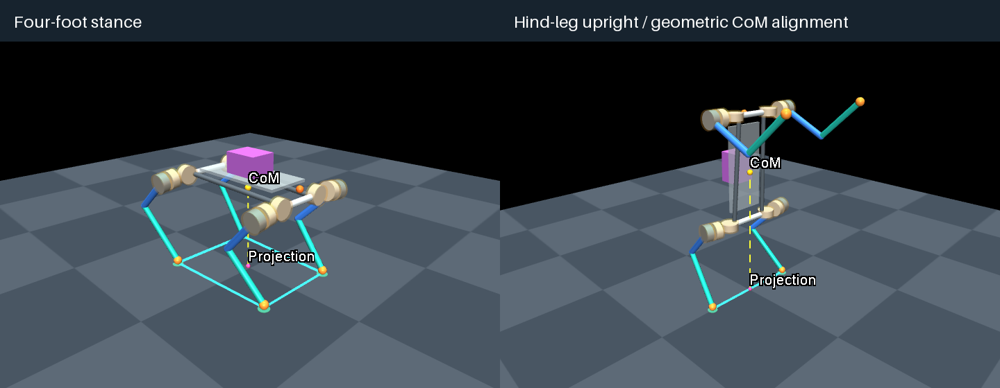

# Quadruped Morphology Workbench

轻量的四足机器人构型配置器：基于 MuJoCo 生成参数化模型，使用逆运动学探索姿态，并显示载荷、质量、重心及其地面投影。

[English README](README.md) · [英文详细操作](README_EN.md) · [代码来源与参考项目](SOURCES.md)

实现原理：[中文版](documents/kinematics-dynamics-zh.md) · [English](documents/kinematics-dynamics-en.md)，涵盖解析 IK、质量惯量、支撑几何与静力关节需求。



## 开发基础与来源

当前代码是在本项目中独立实现的，使用 **MuJoCo** 作为模型编译、运动学和渲染基础，使用 NumPy、Pillow 和 Python 自带的 Tkinter。生成器、参数窗口、解析 IK、质量惯量校核和测试在项目中逐步开发，编码过程使用了 OpenAI Codex 辅助。

最初的研究参考是 [Transformer Transformer: A Unified Model for Motion-Conditioned Robot Co-design](https://github.com/real-stanford/transformer-transformer)。**当前版本没有复用该项目的源码、机器人资产、数据集、模型或训练流程，也没有集成它的生成器。** 因此应将它标为研究参考，而不是声称本仓库由其代码改造而来。详细来源见 [SOURCES.md](SOURCES.md)。

## 安装和启动

当前已在 Apple Silicon Mac 上验证；使用 Python 3.12。先安装 [uv](https://docs.astral.sh/uv/getting-started/installation/)，在终端运行：

```sh
git clone https://github.com/peiyuwang1018/quadruped-morphology-workbench.git
cd quadruped-morphology-workbench
uv sync --locked
.venv/bin/python -m quadruped_codesign.cli panel --config configs/fusion_reference.toml
```

环境创建后，也可在 Finder 双击 `Open Workbench.command`。窗口需要支持 Tk 的 Python 和桌面图形会话。项目内部模块名仍是 `quadruped_codesign`，与 GitHub 仓库名不同不会影响使用。

## 一起做一个小实验

1. 在 **Stance** 选择 **Hind-leg upright**，观察后肢直立姿态。
2. 金色点是重心，粉色点是地面投影，青色线是后足支撑线段。点击 **Align CoM projection**，比较对齐前后的线段偏差。
3. 切回 **Four-foot stance**，此前的四足参数会保留；点击 **Save config & model** 可保存独立候选。

**Geometry** 调整前后腿长和安装间距；**Stance** 调整姿态与足端目标；**Mass** 调整声明的质量估计；**Payload** 调整固定载荷。Fusion 界面使用 mm、deg、kg，配置文件使用 SI 单位，重心读数为世界坐标。无效参数会保留上次有效预览并禁止保存。

后肢直立时，**Stance → Front limbs** 可调整左右镜像的肩滚转、肩俯仰与肘角。前肢改变后会重新计算重心，但不会自动移动后足；需要时单独点击对齐。

勾选预览上方的 **Inspect**，左侧切换为部件查看器。选择部件后，**Mass** 显示质量来源、局部/世界质心与惯量，**Pose** 显示关节角度和派生尺寸，**Model** 显示整机质量、实际足间距和包络间隙。**Selected body** 只看当前刚体，**Body + descendants** 包含其下游刚体；橙色高亮和白色质心标记对应当前选择。取消 **Inspect** 即可回到参数编辑。详细定义和实验见 [部件查看说明](docs/model-inspector.md)。

**Inspect → Static** 查看整机静力基准：平地、重力、左右均分、仅竖直支撑力。先验证整机力与力矩平衡，再给出各关节输出端力矩。默认后肢直立姿态未平衡；单独点击对齐后，才在容差内报告关节需求。前臂姿态改变后可能再次失衡。横向重心偏置需要不等分配，显示超出当前基准；不把它当作机器人一定无法站立。未平衡候选仍可保存，其力矩结果留空。公式、例子及范围见 [静力计算说明](docs/static-loads.md)。

## 输出与验证

每个候选保存到 `outputs/panel/时间戳/`，包括完整配置、MJCF、检查报告、当前渲染图和范围说明。检查报告的 `inspection` 字段包含所有部件及其下游组合的完整精度数据，使用 SI 单位。输出与虚拟环境不进入 Git。

`statics` 字段另存分配规则、支撑力、平衡残差和满足条件时的关节力矩。顶层 `passed` 仍只表示几何/运动学检查通过，静力结果请读 `statics.equilibrium_within_tolerance`。

```sh
.venv/bin/python -m quadruped_codesign.cli generate --config configs/fusion_reference.toml --output outputs/robot.xml
.venv/bin/python -m quadruped_codesign.cli check outputs/robot.xml
.venv/bin/python -m unittest discover -s tests -v
# 在有桌面的环境运行完整窗口/渲染检查：
QUADRUPED_UI_TESTS=1 .venv/bin/python -m unittest discover -s tests -v
```

macOS 独立 MuJoCo 查看器需要用 `.venv/bin/mjpython -m quadruped_codesign.cli view outputs/robot.xml`；参数窗口使用普通 Python。测试覆盖运动学、质量惯量、部件聚合、窗口交互和渲染重绘。早期八关节教学配置和 Fusion v1 快照仍可重载。

## 当前边界

这是构型与冻结姿态探索工具。十二关节模型尚无 actuator；传动、转子惯量、力矩/速度限制、主动站立控制、步态与 RL 尚未实现。Isaac Lab 迁移未经验证。

静力页给出的是当前简化模型的理想关节输出端需求。近端同轴电机的传动映射与效率未定，不能直接把结果当作电机轴力矩，也不代表电机容量、真实站立稳定性或最优构型。

部分安装距离、框架质量、连杆密度和关节范围仍为明确声明的估计。示例总质量约 30.53 kg，不能作为实机辨识值。直立使用单独暂定的髋范围约 −77° 至 +160°，未按硬件校准。

四足投影位于支撑多边形内是几何筛查；两只理想点足的线段没有面积，即使投影对齐也不代表能稳定站立或电机能承载。详细说明见 [构型假设](docs/fusion-reference.md) 与 [站姿和支撑几何](docs/support-preview.md)。

尚未选定项目开源许可证；依赖与参考项目保留各自许可。
