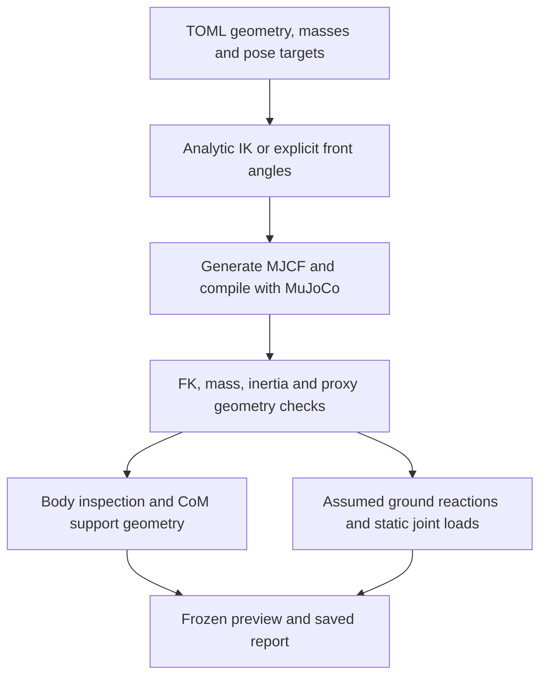

# Kinematics and dynamics implementation

[中文版本](kinematics-dynamics-zh.md) · [Project README](../README.md)

Implementation reviewed: **2026-11-11**. The main subject is `fusion_reference_v2`; legacy differences are listed below. This document describes the implemented tool, not a validated physical robot.

## 1. What is implemented

| Layer | Current functionality |
|---|---|
| Geometry | Parameterized MJCF, separate front/hind segment lengths, mirrored left/right limbs, proximal coaxial motor proxies and fixed payload |
| Kinematics | Analytic 3R inverse kinematics (IK), MuJoCo forward kinematics (FK), four-foot/upright frozen poses, direct front-limb angles in upright mode |
| Mass properties | Primitive mass/inertia validation, whole-model and selected-body/subtree centre of mass (CoM), inertia aggregation |
| Support geometry | CoM projection, convex support polygon or finite hind-foot segment, bounded foot-target alignment |
| Static mechanics | Explicit vertical load sharing, whole-model equilibrium checks, conditional ideal joint-output torques |
| Dynamic execution | Optional uncontrolled gravity drop; no standing controller, gait controller, RL or morphology optimizer |

The current Fusion model has **12 hinges, one free base, `nq=19`, `nv=18`, and zero actuators**. The quaternion requires four position coordinates but only three rotational velocity coordinates. No Pinocchio dependency is used. The project independently implements its generators and analytic methods; Transformer Transformer is a research reference, not incorporated source code. See [provenance](../SOURCES.md).



Geometry validation and static feasibility are separate: an unbalanced but geometrically valid candidate remains saveable.

## 2. Frames, dimensions and model tree

Configuration units are m, kg, s, rad, N and N·m. The Fusion UI displays mm and degrees. World z points upward; world x is the horizontal reference-forward direction and y points left. The torso frame rotates with the body. Positive torso pitch about y lowers the front; the default upright pitch is −π/2. Quaternions use w/x/y/z order.

For leg ℓ, let s=+1 for left and −1 for right, and f=+1 for front and −1 for rear. The torso-frame mounting anchor is

$$a_\ell=(fD/2,\;s w_\ell/2,\;f\Delta z/2)^T.$$

Here D is `d_hip_shoulder`, w is the shoulder/hip datum width, and Δz is shoulder-minus-hip height. The default Δz=−0.030 m means lower shoulders. These widths are **mounting datum widths**, not actual upper-link-start spacing.

The v2 upper-link offset in the roll carrier is o=(0,d,0), with

$$d=s(\text{pitch\_outboard}+\text{envelope\_length}+\text{axial\_gap}+\text{thigh\_axial\_offset}).$$

Its default magnitude is 0.095 m. The upper link begins at the outer knee-drive module's axial centre plus trim. The hip/knee modules are coaxial along local y. This arrangement specifies geometry and mass ownership, not motor-to-joint transmission coupling.

```text
torso (free base)
├── payload (fixed, optional)
├── ℓ_roll_motor (fixed to torso)
└── ℓ_carrier (roll hinge; two proximal pitch-drive masses)
    └── ℓ_thigh (hip/shoulder-pitch hinge; upper link)
        └── ℓ_shank (knee/elbow hinge; lower link + foot)
```

This branch repeats for FL, FR, RL and RR. A carrier subtree excludes the roll-motor sibling. Each shank includes its foot mass; there is no independent foot rigid body.

## 3. Forward and inverse kinematics

Source: [`fusion.py`](../src/quadruped_codesign/fusion.py), especially `anchor`, `thigh_origin`, `rotation_y`, `solve_pose` and `generate_fusion_mjcf`.

Let R=Ry(ψ) be torso orientation and b its world origin. Given rear mounting height h, the generator sets b=(0,0,h−[Ra_RL]z). Thus the requested height belongs to the rear carrier anchor, not the torso bottom or offset upper-link origin.

Let qr, qh and qk be roll, hip and knee angles, and u1=(0,0,−L1), u2=(0,0,−L2). The corresponding foot-centre FK is

$$p_F=b+R\left[a_\ell+R_x(q_r)\left(o+R_y(q_h)u_1+R_y(q_h+q_k)u_2\right)\right].$$

The knee position omits the final lower-link term. The upper-link origin omits both segment terms. These expressions explain the hierarchy; MuJoCo computes the actual compiled FK through `mj_forward`, and the evaluator compares foot sites against the requested targets.

### Foot targets

For a supporting leg, with anchor world position pA=b+Raℓ, the target is

$$p_T=(p_{A,x}+\delta x_\ell,\;s W_\ell/2,\;r_{foot})^T.$$

W is the requested full foot-centre spacing, δx is a **world-horizontal** offset, and rfoot=0.026 m. Setting the centre at the radius puts the spherical surface at ground z=0. Convert to the pre-roll anchor frame: (x,y,z)=Rᵀ(pT−pA).

### Analytic 3R solution

The roll-offset geometry satisfies (y,z)=Rx(qr)(d,−t) in the yz plane. The implemented branch is

$$r_{yz}=\sqrt{y^2+z^2},\qquad t=\sqrt{r_{yz}^2-d^2},$$
$$q_r=\operatorname{atan2}(y,-z)-\operatorname{atan2}(d,t).$$

The remaining planar target has coordinates (x,−t), with reach r=√(x²+t²). The negative-knee branch is

$$q_k=-\arccos\left(\frac{r^2-L_1^2-L_2^2}{2L_1L_2}\right),$$
$$q_h=\operatorname{atan2}(-x,t)-\operatorname{atan2}(L_2\sin q_k,L_1+L_2\cos q_k).$$

Before evaluating the solution, the code requires r_yz>|d|+0.001 m and |L1−L2|+0.001<r<L1+L2−0.001 m. These are numerical reach/singularity guards, not hardware clearances. The arccos argument is clipped only against round-off after reach checking. Joint angles must then satisfy the selected concept limits. The solver does not search all IK branches or silently change segment lengths.

Four-foot mode solves all four feet. Upright mode solves only the hind feet; front angles are assigned as (s·front_roll, front_hip, front_knee). Front feet must remain more than 10 mm above ground. Separate `upright_limits` permit the concept pose; these limits are not measured mechanical ranges. UI angle controls and mirrored roll limits are in [`fusion_panel.py`](../src/quadruped_codesign/fusion_panel.py).

## 4. Mass, CoM and inertia

Sources: [`mass_properties.py`](../src/quadruped_codesign/mass_properties.py), `fusion.expected_properties`, and [`inspection.py`](../src/quadruped_codesign/inspection.py).

| Element | Approximation |
|---|---|
| Frame | Declared mass, uniform-box inertia; cosmetic rails add no mass |
| Each drive module | Nominal 1.4 kg plus entered extra mass, uniform cylinder |
| Module envelope | Ø118 × 60 mm packaging proxy; zero mass |
| Upper/lower links | Uniform capsules, configurable surrogate density |
| Foot | Sphere, radius 26 mm, mass 0.08 kg, combined with the lower link |
| Payload | Fixed uniform box with independently specified mass, full dimensions and torso-frame centre |

The physical cylinder proxy defaults to Ø107.5 × 43.5 mm. Zero extra mass means unknown casing/driver/bracket mass is omitted. The default frame mass is 8 kg and link density 1000 kg/m³. The resulting total is approximately 30.529541 kg including a 2 kg payload; this is not an identified hardware mass.

### Primitive formulas and checks

For a box of full dimensions a,b,c, I=(m/12)diag(b²+c²,a²+c²,a²+b²). For a cylinder of radius r and axial length L, axial inertia is mr²/2 and each transverse inertia is m(3r²+L²)/12.

A link capsule has endpoints at z=0 and z=−L. L is the endpoint/kinematic length; the total capsule extent is L+2r. With density ρ, define mc=ρπr²L and ms=4ρπr³/3 (both hemispheres together). Then

$$m=m_c+m_s,\quad c=(0,0,-L/2),$$
$$I_x=I_y=\frac{m_c(3r^2+L^2)}{12}+m_s\left(\frac{2r^2}{5}+\frac{3Lr}{8}+\frac{L^2}{4}\right),$$
$$I_z=\frac{m_cr^2}{2}+\frac{2m_sr^2}{5}.$$

The lower capsule and foot sphere are added as mass primitives without subtracting their overlapping volume. Both the cylinder/capsule approximations and that additive convention are modeling choices. Independent formulas are compared with compiled masses, local CoMs and full inertia tensors, rather than merely checking that XML compiles.

### Coordinate transforms and aggregation

Whole-model CoM is cW=Σmi ciW/Σmi. The implementation uses `body_mass` and the world inertial-centre positions `data.xipos`. The CoM in a selected body's frame is Rsᵀ(cW−ps), where ps is its body origin.

MuJoCo stores diagonal principal inertia and an inertial-frame rotation. `body_tensor` reconstructs the body-frame tensor as I_B=R_I diag(I_principal) R_Iᵀ. For a group with CoM cG, aggregation is

$$I_G^W=\sum_i\left[R_i I_i^B R_i^T+m_i\left(\|r_i\|^2\mathbf1-r_i r_i^T\right)\right],\quad r_i=c_i^W-c_G^W.$$

The inspector returns Rsᵀ I_G^W Rs, **about the group CoM**, expressed along the selected body's axes. It is not inertia about the selected origin or a sum of diagonal entries. These field conventions follow the [MuJoCo model/data definitions](https://mujoco.readthedocs.io/en/stable/APIreference/APItypes.html).

Changing length updates geometry, child placement, mass and inertia. Changing only pose preserves a single body's mass/local inertia but moves its world CoM and can change aggregate inertia. In the static calculation, velocities and accelerations vanish: mass, CoM and force lever arms determine gravity/contact loads; inertia tensors become important for subsequent moving-body dynamics.

## 5. Support geometry and alignment

[`support.py`](../src/quadruped_codesign/support.py) projects CoM onto z=0. Four-foot mode constructs the convex hull of contact xy coordinates and reports the minimum signed inward edge distance. Upright mode measures distance to the **finite** rear-foot segment, including endpoint limits. A line has zero area and no positive transverse stability margin.

[`posture.py`](../src/quadruped_codesign/posture.py) aligns CoM by bounded search over foot x targets: a common front/rear shift in four-foot mode, or only a rear-target shift in upright mode. Each trial repeats IK, compilation, geometry checks and CoM evaluation. The search samples 41 bounded shifts plus zero, brackets a sign change where available, then bisects up to 35 times. Invalid trials break a search interval. The x residual target is 0.1 mm; final containment is also checked. Failure preserves the input and does not prove global infeasibility.

Alignment does not change body height, pitch, masses, geometry, lateral targets or limits. Front-angle edits do not automatically align the feet. Geometric containment can pass while the equal-left/right static rule is inapplicable, for example with a lateral payload offset.

## 6. Static joint-load calculation

Source: [`statics.py`](../src/quadruped_codesign/statics.py). Detailed operation: [static-load guide](../docs/static-loads.md).

### Explicit force allocation

The baseline assumes level ground, zero velocity/acceleration, downward world-z gravity, no external task wrench, and ideal point feet supplying only nonnegative vertical forces. Each left/right pair shares equally. Lateral CoM offsets requiring unequal sharing are reported as `outside_assumptions`; the code does not infer physical impossibility.

For weight W=Mg, front/rear contact coordinates xF,xR, and CoM xC:

$$F_F=W\frac{x_C-x_R}{x_F-x_R},\qquad F_R=W-F_F.$$

Each foot receives half the corresponding pair load. A required negative reaction means the pose is unbalanced under unilateral contacts. Degenerate fore/aft separation is outside this formula. In upright mode each rear foot gets W/2, and the combined force line must pass through the CoM projection. Front feet have no contact force.

### Generalized forces

For the ideal model without additional passive forces, write

$$M(q)\dot v+c(q,v)=\tau_{generalized}+\sum_iJ_i(q)^TF_i.$$

At rest c(q,0)=g(q), so the required generalized load is

$$\tau_{required}=g(q)-\sum_iJ_i(q)^TF_i.$$

This follows the [MuJoCo equations of motion](https://mujoco.readthedocs.io/en/stable/computation/index.html). The implementation creates private stationary data, runs `mj_forward`, evaluates g with [`mj_rne(..., flg_acc=0)`](https://mujoco.readthedocs.io/en/stable/APIreference/APIfunctions.html#mj-rne), and maps world forces using [`mj_jac`](https://mujoco.readthedocs.io/en/stable/APIreference/APIfunctions.html#mj-jac) at each ground point attached to the foot's body. It does not use `qfrc_constraint` or soft-contact solver reactions.

The six free-base entries of τrequired cannot be supplied by joint motors. Both their residual wrench and the independently computed world force/moment sums must pass before hinge torques are reported. World moment balance is computed about whole-model CoM. The exported base-required force is in world axes; its moment is about the base origin in base axes. Each hinge torque is positive along that MJCF joint's axis. Exported joint rows include gravity-only, contact contribution and their difference. Airborne front limbs still need their gravity-holding torque.

### Tolerances and result states

Force tolerance is max(10⁻⁸ N,W·10⁻⁸); moment tolerance is W·10⁻⁴ m, matching the alignment tolerance. Default moment tolerance is about 0.02995 N·m. `balanced` means within these numerical tolerances, not exact equilibrium or stable feedback control. `unbalanced` retains trial loads/residuals but has an empty torque list. `outside_assumptions` indicates a model or allocation case the baseline does not cover.

Declared feet must lie on ground. Springs, friction loss, gravity compensation, tendons and equality constraints are rejected by this baseline. Joint damping contributes zero at rest. Joint-stop reactions are not used as extra supports. Ideal joint-output demands cannot be converted to motor-shaft torque until transmission coupling, ratios and efficiency are specified; no capacity or thermal check is implemented.

## 7. UI, reports and dynamic scope

[`panel_model.py`](../src/quadruped_codesign/panel_model.py) builds a candidate, checks geometry, then adds `inspection` and `statics`. [`panel.py`](../src/quadruped_codesign/panel.py) renders only the last valid candidate; invalid geometry keeps the previous preview and disables saving. Static failure does not invalidate geometry. `Inspect → Mass/Pose/Model/Static` is implemented in [`inspector_panel.py`](../src/quadruped_codesign/inspector_panel.py).

CoM/support markers and selection highlights modify the render scene only. [`visualization.py`](../src/quadruped_codesign/visualization.py) manages renderer contexts when replacing models; camera dragging rerenders without rebuilding the model or advancing time.

Snapshots contain config, MJCF, image, scope note and `validation.json`. Top-level `passed` means geometric checks passed. `statics.equilibrium_within_tolerance` is the separate mechanical result. Reports retain full precision in SI units even when UI values are rounded.

The Fusion CLI `check` performs frozen-pose checks and rejects nonzero `--steps`; full inspection/static results are available from panel snapshots or `Preview.build(shape).report`. The optional viewer `--simulate` advances an **uncontrolled gravity drop**, not an IK-driven standing controller. Legacy eight-hinge models retain a finite-drop numerical test and eight toy ±25 N·m actuator ranges; these do not apply to the twelve-hinge Fusion model. Fusion v1 snapshots retain the old fore/aft motor arrangement and zero upper-origin offset. No Isaac Lab transfer has been validated.

## 8. Reproduction and verification

From the repository root, after installing the locked environment:

```sh
.venv/bin/python -m quadruped_codesign.cli panel --config configs/fusion_reference.toml
QUADRUPED_UI_TESTS=1 .venv/bin/python -m unittest discover -s tests -v
```

The full desktop suite had **63 passing tests** at this revision. Coverage includes FK/IK, primitive mass/inertia, rotated subtree aggregation, independent subtree force-moment sums, finite-difference virtual work, floating-base residual frames, limits, invalid-input rollback, snapshots and rendered-pixel regressions. Passing validates these implementation checks, not a physical robot.

| Default model example | Static result | Largest absolute joint torque |
|---|---|---:|
| Four-foot | Within tolerance | Rear knee 19.66 N·m |
| Upright before alignment | Unbalanced moment about 9.87 N·m | Withheld |
| Upright after alignment | Within tolerance | Rear knee 40.88 N·m |

To observe the distinction, open upright mode, inspect Static, align separately, then change Shoulder pitch to 45°. The unchanged hind targets can lose balance; align again before comparing torque demands. These examples illustrate the current mass/allocation assumptions, not optimized configurations.

Future comparisons should fix payload, target height/pitch and alignment/allocation rules, vary the intended geometric parameters, and retain unreachable, colliding and unbalanced candidates in the results. Motor transmission, capacity, dynamic task costs and controllers require additional modeling before morphology–control co-design.
