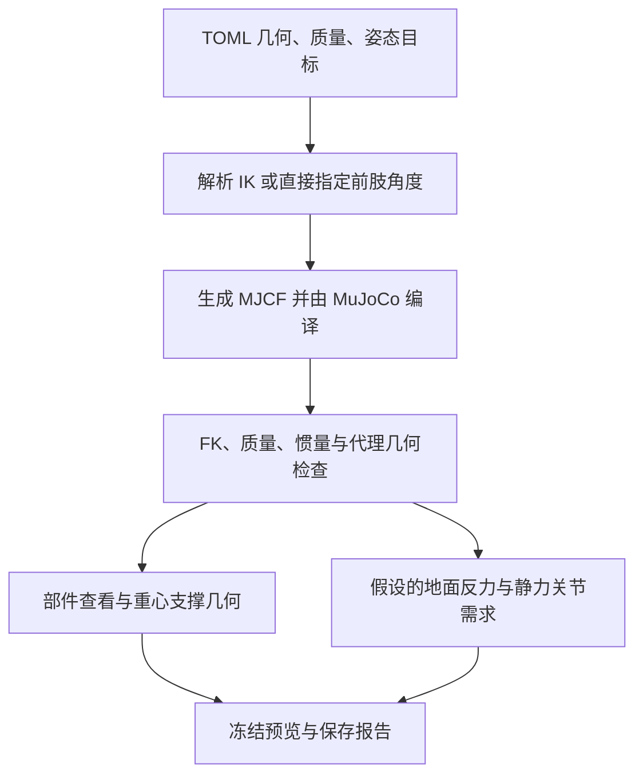

# 运动学与动力学功能实现原理

[English version](kinematics-dynamics-en.md) · [项目说明](../README_ZH.md)

实现核对日期：**2026-11-11**。本文以 `fusion_reference_v2` 为主，另说明旧模型的区别。描述对象是当前工具的实现，不是经过验证的实物机器人。

## 1. 已经实现的内容

| 层次 | 当前功能 |
|---|---|
| 几何 | 参数化 MJCF、前后肢独立段长、左右镜像、近端同轴电机代理几何、固定载荷 |
| 运动学 | 解析三转动关节逆运动学（IK）、MuJoCo 正运动学（FK）、四足/后肢直立冻结姿态、直立前肢角度直接控制 |
| 质量属性 | 基本几何体质量与惯量校核、整机及部件/子树质心、组合惯量 |
| 支撑几何 | 重心投影、支撑凸包或有限后足线段、有界足端目标对齐 |
| 静力学 | 明确的竖直载荷分配、整机平衡检查、满足条件时的理想关节输出端力矩 |
| 动态执行 | 可选无控制重力下落；尚无站立控制器、步态控制器、RL 或形态优化器 |

Fusion 模型有 **12 个 hinge、一个浮动基座，nq=19、nv=18、actuator 数量为 0**。四元数用四个位置坐标表示三维转动，所以位置与速度维数不同。没有引入 Pinocchio。生成器和解析方法在本项目中独立实现；Transformer Transformer 是研究参考，没有复用其源码。详见[开发来源](../SOURCES.md)。



几何有效性与静力可行性分开：几何有效但未平衡的候选仍允许保存。

## 2. 坐标系、尺寸与模型树

配置采用 m、kg、s、rad、N、N·m；Fusion 界面采用 mm 和 deg。世界 z 向上，x 是水平参考前向，y 向左；机身坐标随姿态旋转。绕 y 的正机身俯仰角使前端降低，默认直立俯仰为 −π/2。四元数顺序为 w/x/y/z。

对第 ℓ 条腿，左侧 s=+1、右侧 s=−1，前肢 f=+1、后肢 f=−1。机身坐标下安装基准点为：

$$a_\ell=(fD/2,\;s w_\ell/2,\;f\Delta z/2)^T.$$

D 是 `d_hip_shoulder`，w 是肩/髋安装基准宽度，Δz 是肩减髋的高度差。默认 Δz=−0.030 m，表示肩部更低。这里的宽度不是两侧大腿实际起点间距。

v2 大腿起点相对 roll carrier 的偏置为 o=(0,d,0)，其中：

$$d=s(\text{pitch\_outboard}+\text{envelope\_length}+\text{axial\_gap}+\text{thigh\_axial\_offset}).$$

默认 |d|=0.095 m。大腿从外侧膝驱动模组的轴向中点加微调量开始。髋/膝驱动模组沿局部 y 同轴布置；这里只规定几何和质量归属，没有建立电机到关节的传动耦合。

```text
torso（浮动基座）
├── payload（固定，可选）
├── ℓ_roll_motor（固定到 torso）
└── ℓ_carrier（roll 关节；两个近端俯仰驱动模组质量）
    └── ℓ_thigh（髋/肩俯仰关节；上段连杆）
        └── ℓ_shank（膝/肘关节；下段连杆和足球）
```

FL、FR、RL、RR 各有上述分支。carrier 子树不含其 roll_motor 兄弟刚体；shank 包括足球质量，没有独立的足端刚体。

## 3. 正运动学与逆运动学

代码：[fusion.py](../src/quadruped_codesign/fusion.py) 中的 `anchor`、`thigh_origin`、`rotation_y`、`solve_pose`、`generate_fusion_mjcf`。

令 R=Ry(ψ) 为机身姿态，b 为机身世界原点。给定后髋安装基准高度 h，生成器设 b=(0,0,h−[Ra_RL]z)。因此高度控制的是后 carrier 安装点，不是机身底面或带侧向偏置的大腿起点。

记 qr、qh、qk 为 roll、hip、knee 角，u1=(0,0,−L1)、u2=(0,0,−L2)，足心正运动学为：

$$p_F=b+R\left[a_\ell+R_x(q_r)\left(o+R_y(q_h)u_1+R_y(q_h+q_k)u_2\right)\right].$$

去掉末尾小腿项得到膝位置；去掉两段连杆项得到大腿起点。这一表达式解释模型树的几何关系。实际编译后的 FK 由 `mj_forward` 计算，再把足端 site 与目标位置比较。

### 足端目标

对支撑腿，安装点世界位置 pA=b+Raℓ，足心目标为：

$$p_T=(p_{A,x}+\delta x_\ell,\;s W_\ell/2,\;r_{foot})^T.$$

W 是完整左右足心间距，δx 是世界水平方向偏移，rfoot=0.026 m。足心位于一个球半径高处，使球底接触 z=0。转换到 roll 旋转前的安装点坐标：(x,y,z)=Rᵀ(pT−pA)。

### 解析三关节求解

带侧向偏置的 yz 几何满足 (y,z)=Rx(qr)(d,−t)。当前采用：

$$r_{yz}=\sqrt{y^2+z^2},\qquad t=\sqrt{r_{yz}^2-d^2},$$
$$q_r=\operatorname{atan2}(y,-z)-\operatorname{atan2}(d,t).$$

余下平面目标为 (x,−t)，距离 r=√(x²+t²)。采用负膝角分支：

$$q_k=-\arccos\left(\frac{r^2-L_1^2-L_2^2}{2L_1L_2}\right),$$
$$q_h=\operatorname{atan2}(-x,t)-\operatorname{atan2}(L_2\sin q_k,L_1+L_2\cos q_k).$$

求解前要求 r_yz>|d|+0.001 m，以及 |L1−L2|+0.001<r<L1+L2−0.001 m。这是可达边界和奇异位形的数值留量，不是实机安全间隙。先通过可达性检查，再对 arccos 参数做舍入误差截断；最后检查各关节的概念限位。算法不搜索所有 IK 分支，也不偷偷改变腿长。

四足模式求解四条腿。直立模式只求解后肢，前肢直接设为 (s·front_roll, front_hip, front_knee)，并要求前足球底离地超过 10 mm。`upright_limits` 是单独的概念活动范围，尚未按硬件测量。界面角度控制和左右镜像 roll 限位见 [fusion_panel.py](../src/quadruped_codesign/fusion_panel.py)。

## 4. 质量、质心和惯量

代码：[mass_properties.py](../src/quadruped_codesign/mass_properties.py)、`fusion.expected_properties`、[inspection.py](../src/quadruped_codesign/inspection.py)。

| 元素 | 近似模型 |
|---|---|
| 框架 | 指定质量、均匀箱体惯量；外观杆件不增加质量 |
| 每个电机模组 | 名义 1.4 kg 加用户填写的额外质量，近似为均匀圆柱 |
| 电机包络 | Ø118 × 60 mm 安装包络，质量为零 |
| 大腿/小腿 | 均匀胶囊体，使用可调的替代密度 |
| 足球 | 半径 26 mm、质量 0.08 kg，与小腿合为一个刚体 |
| 载荷 | 固定均匀箱体，质量、完整尺寸和机身坐标下中心独立指定 |

质量圆柱默认 Ø107.5 × 43.5 mm。额外质量为零表示尚未计入未知外壳、驱动器、支架质量。框架默认 8 kg、连杆密度默认 1000 kg/m³；得到含 2 kg 载荷的总质量约 30.529541 kg。这不是实机辨识值。

### 基本几何体公式与校核

完整边长 a,b,c 的箱体惯量为 I=(m/12)diag(b²+c²,a²+c²,a²+b²)。半径 r、轴向长度 L 的圆柱，轴向惯量 mr²/2，横向惯量 m(3r²+L²)/12。

胶囊连杆端点为 z=0 和 z=−L。L 是端点/运动学长度，胶囊总外形长度为 L+2r。密度为 ρ，定义圆柱质量 mc=ρπr²L，两个半球总质量 ms=4ρπr³/3：

$$m=m_c+m_s,\quad c=(0,0,-L/2),$$
$$I_x=I_y=\frac{m_c(3r^2+L^2)}{12}+m_s\left(\frac{2r^2}{5}+\frac{3Lr}{8}+\frac{L^2}{4}\right),$$
$$I_z=\frac{m_cr^2}{2}+\frac{2m_sr^2}{5}.$$

小腿胶囊和足球按两个质量元素直接相加，没有扣除重叠体积。这与圆柱、胶囊近似一样，是当前模型约定。代码用独立公式核对编译后的质量、局部质心和完整惯量张量，而不只是检查 XML 能否编译。

### 坐标变换与聚合

整机质心 cW=Σmi ciW/Σmi，取自编译后的 `body_mass` 和世界惯性中心 `data.xipos`。选中刚体坐标下的质心为 Rsᵀ(cW−ps)，其中 ps 为该刚体原点。

MuJoCo 保存主惯量对角值和惯性坐标系旋转。`body_tensor` 先恢复刚体坐标下张量 I_B=R_I diag(I_principal) R_Iᵀ。对于质心为 cG 的组合：

$$I_G^W=\sum_i\left[R_i I_i^B R_i^T+m_i\left(\|r_i\|^2\mathbf1-r_i r_i^T\right)\right],\quad r_i=c_i^W-c_G^W.$$

查看器返回 Rsᵀ I_G^W Rs：惯量关于组合质心，坐标轴沿选中的刚体。它不是关于选中原点的惯量，也不能只把对角元素相加。字段含义见 [MuJoCo 模型与状态定义](https://mujoco.readthedocs.io/en/stable/APIreference/APItypes.html)。

改变腿长会同步改变几何、子刚体位置、质量和惯量。只改变姿态不会改变单个刚体的质量及局部惯量，但会移动世界质心，并可能改变组合惯量。静力计算中速度和加速度为零，重力/接触需求主要由质量、质心与力臂决定；惯性张量在后续运动动力学中才参与惯性载荷计算。

## 5. 支撑几何与对齐

[support.py](../src/quadruped_codesign/support.py) 将质心投影到 z=0。四足采用接触点 xy 的凸包，报告到边界的最小有符号内向距离；直立采用有限后足线段，检查到线段及其端点的距离。线段没有面积，也没有正横向稳定裕度。

[posture.py](../src/quadruped_codesign/posture.py) 在足端 x 目标的允许范围内搜索：四足同时平移前后目标，直立只平移后足目标。每个候选重新运行 IK、编译、几何检查和质心计算。先采样 41 个有界偏移加零点，在可用区间找符号变化，再最多二分 35 次；无效候选会中断区间。x 方向残差目标为 0.1 mm，最后还检查投影是否位于有限支撑范围内。失败保留输入，不证明全局无解。

对齐不改高度、俯仰、质量、构型、横向目标或关节限位。调整前肢角度不会自动移动后足。几何包含关系通过，也可能超出左右均分的静力规则，例如载荷横向偏置时。

## 6. 静力关节需求计算

代码：[statics.py](../src/quadruped_codesign/statics.py)。操作细节见[静力页说明](../docs/static-loads.md)。

### 明确的反力分配

基准假设：平地、速度/加速度为零、重力沿世界 −z、无外部任务力或力矩，理想点足仅提供非负竖直力。每对左右腿均分。横向重心偏移需要左右不等分配时，返回 `outside_assumptions`，不把它解释为物理上不可能。

总重 W=Mg，前后接触点 x 坐标 xF、xR，质心 xC：

$$F_F=W\frac{x_C-x_R}{x_F-x_R},\qquad F_R=W-F_F.$$

每只足承担所在腿对的一半。若需要负反力，意味着足要拉住地面，单向接触下不平衡。前后 x 间距退化时超出本公式。直立时两只后足各承担 W/2，合力作用线须通过质心投影；前足不提供反力。

### 广义力计算

忽略额外被动力的理想模型可写为：

$$M(q)\dot v+c(q,v)=\tau_{generalized}+\sum_iJ_i(q)^TF_i.$$

静止时 c(q,0)=g(q)，所需广义力为：

$$\tau_{required}=g(q)-\sum_iJ_i(q)^TF_i.$$

这与 [MuJoCo 运动方程](https://mujoco.readthedocs.io/en/stable/computation/index.html)一致。实现创建独立的零速度状态，运行 `mj_forward`，用 [`mj_rne(..., flg_acc=0)`](https://mujoco.readthedocs.io/en/stable/APIreference/APIfunctions.html#mj-rne) 得到 g，再用 [`mj_jac`](https://mujoco.readthedocs.io/en/stable/APIreference/APIfunctions.html#mj-jac) 在附着于足部刚体的地面接触点映射世界反力。没有采用 `qfrc_constraint` 或软接触求解器反力。

τrequired 的六个浮动基座分量无法由关节电机直接提供。必须同时通过基座残差和独立的世界合力/合矩检查，才报告 hinge 力矩。世界合矩关于整机质心；导出的基座所需力沿世界轴，基座所需力矩关于基座原点、沿基座轴。关节力矩正号沿该 MJCF 关节正轴。每行报告重力项、接触贡献及两者之差。悬空前肢没有接触力，仍需克服自身重力。

### 容差与状态

力容差 max(10⁻⁸ N,W·10⁻⁸)，力矩容差 W·10⁻⁴ m，与对齐精度一致。默认力矩容差约 0.02995 N·m。`balanced` 表示数值容差内通过，不表示精确平衡或反馈稳定；`unbalanced` 保留试算载荷与残差，力矩列表为空；`outside_assumptions` 表示本模型或分配规则尚不覆盖该情况。

声明的支撑足必须在地面上。本基准拒绝弹簧、friction loss、重力补偿、tendon 和 equality constraint；现有关节阻尼在静止时为零，不借用关节限位挡块反力作支撑。在传动耦合、传动比与效率确定前，理想关节输出需求不能直接换算成电机轴力矩，也没有电机容量或热性能检查。

## 7. 界面、报告与动态功能边界

[panel_model.py](../src/quadruped_codesign/panel_model.py) 构建候选并检查几何，再加入 `inspection` 与 `statics`。[panel.py](../src/quadruped_codesign/panel.py) 显示上次有效候选；几何输入无效时保留旧预览并禁用保存。静力失败不会把有效几何判为无效。`Inspect → Mass/Pose/Model/Static` 由 [inspector_panel.py](../src/quadruped_codesign/inspector_panel.py) 实现。

质心、支撑标记和高亮只修改渲染场景。[visualization.py](../src/quadruped_codesign/visualization.py) 在模型替换时管理渲染上下文；拖动相机只重新绘图，不重建模型或推进仿真时间。

快照保存配置、MJCF、图像、范围说明和 `validation.json`。顶层 `passed` 指几何检查；`statics.equilibrium_within_tolerance` 单独表示力学结果。界面可舍入，报告保持完整精度和 SI 单位。

Fusion CLI 的 `check` 仅检查冻结姿态，拒绝非零 `--steps`；完整部件/静力报告来自窗口保存或 `Preview.build(shape).report`。查看器可选 `--simulate` 只执行无控制重力下落，不是由 IK 驱动的站立控制器。旧八关节模型保留有限时间下落数值测试及八个教学用 ±25 N·m actuator 范围，不能套用到十二关节 Fusion 模型。Fusion v1 快照保留旧的电机前后错开布局和零大腿起点偏置。Isaac Lab 迁移尚未验证。

## 8. 复现与验证

安装锁定环境后，在仓库根目录运行：

```sh
.venv/bin/python -m quadruped_codesign.cli panel --config configs/fusion_reference.toml
QUADRUPED_UI_TESTS=1 .venv/bin/python -m unittest discover -s tests -v
```

本版本完整桌面测试 **63 项通过**。覆盖 FK/IK、基本质量惯量、旋转后的子树聚合、独立子树受力矩求和、有限差分虚功、基座残差坐标、限位、无效输入回退、快照及渲染像素回归。这些是实现校核，不是实机验证。

| 默认模型示例 | 静力结果 | 最大关节需求绝对值 |
|---|---|---:|
| 四足 | 容差内通过 | 后膝 19.66 N·m |
| 直立、未对齐 | 未平衡合矩约 9.87 N·m | 不报告 |
| 直立、对齐后 | 容差内通过 | 后膝 40.88 N·m |

可先打开直立模式查看 Static，单独对齐，再将 Shoulder pitch 改为 45°。后足目标保持不变时可能再次失衡，需要重新对齐后比较需求。这些结果仅说明当前质量与分配假设，不代表最优构型。

后续形态比较应固定载荷、目标高度/俯仰、姿态对齐与反力分配规则，只改变待研究的几何量，并保留不可达、碰撞和未平衡候选。正式 morphology–control co-design 还需要传动、执行器容量、动态任务指标和控制器。
